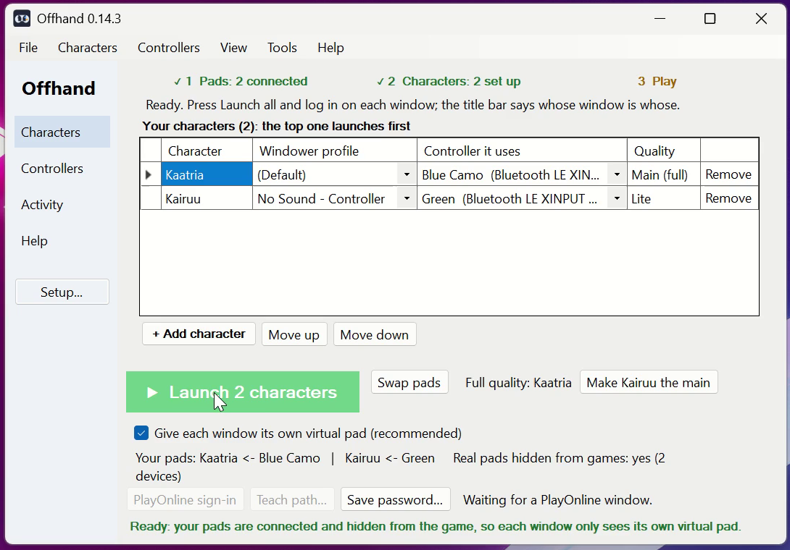
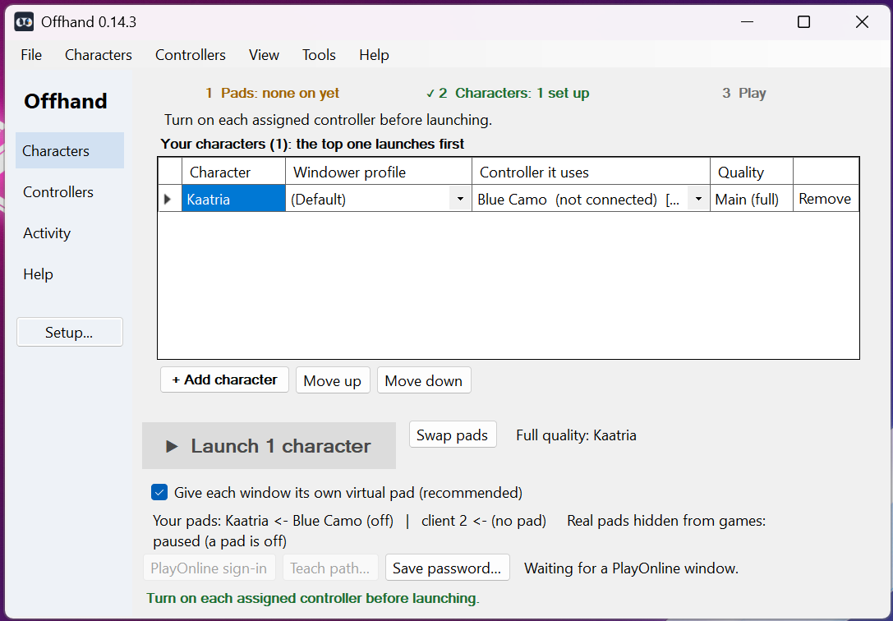
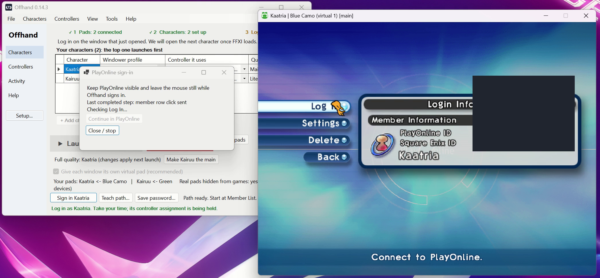

# Offhand

*A controller per game window. Works with FFXI (Windower 4). Free, MIT licence.*

**Free and non-commercial: no ads, no donations, no paid tier, nothing is sold.**

**One controller per game window. Swap pads between windows without restarting anything.**

If you run two Final Fantasy XI clients on one PC and play with controllers, you know the pain: FFXI picks one
controller for every client, a pad that falls asleep or reconnects loses its window, and swapping who holds which pad means
restarting the game. Offhand fixes that.

> **Early build, no promises.** This is a one-person project in testing. It can break, and nobody can promise it is safe to use
> with the game (see "The honest risk" below). Please read that section before you use it.

## Screenshots and demo

[Watch or download the masked launch demo](media/offhand-demo-masked.mp4) (silent, about 2 minutes 22 seconds).

Character setup and optional PlayOnline sign-in

Footage shows version 0.14.3. Character names are intentionally visible; account identifiers and
password fields are covered in the demo. See [media notes](media/README.md).

## What it works with
- Windows 11. Windows 10 has not been verified.
- **Windower 4** (Ashita and other launchers are untested and not supported).
- Xbox Wireless Controllers over Bluetooth (tested); two clients (tested). This release supports up to two characters. Other controller models and USB input are not supported yet.
- Two free drivers by the same author, installed separately: ViGEmBus and HidHide (see `THIRD-PARTY-NOTICES.md`).

## What it does
- Starts your Windower profiles in order, each with its own controller.
- Gives every window a **virtual Xbox pad** that never disappears. The real pads feed them behind the scenes, so a pad that
  sleeps, charges or reconnects just comes back to the same window.
- **Swap pads between windows live**: one button or the tray menu. No restart, no stuck buttons.
- Names every window `Character | pad` so you always know which account you are logging into.
- Hides your real pads from the game while it runs, and **gives them back to Steam and Windows when you exit**.
- Remembers pads by their Bluetooth address and lets you write a note for each ("white, tape on back").

## What you need
- Windows 11, Windower 4, FFXI on PC.
- Two free drivers by the same author, installed once: **ViGEmBus** (the virtual pads) and **HidHide** (hides the real ones).
  The Setup screen shows what is missing and links to the download pages.
- Xbox Wireless Controllers (Bluetooth). Other controller families and USB input need further testing.

## First run and navigation
The setup wizard walks you through Windower, controller/driver checks, your character list, and a review before saving. Cancel leaves your settings unchanged. An unfinished first-run setup opens again next time. Existing setups stay available without repeating the wizard.

Use the sidebar to open **Characters**, **Controllers**, **Activity** (the log), or **Help**. Name your pads on Controllers and assign them on Characters. Launch, Stop launching, and Swap pads stay available below every section. The menu bar keeps the existing keyboard shortcuts and advanced tools. Setup can be reopened from the sidebar or Tools menu while no game session is active.

## Every play session
1. Open Offhand and turn on every assigned controller. Wait for the ready status before launching.
2. Press **Launch** and log in on each window, manually or using your taught sign-in path. Each controller assignment stays held without a login deadline.
3. To stop an unfinished launch, close its waiting PlayOnline window, then press **Stop launching**.
4. Quit the last-launched client first. Exit Offhand from the tray icon when you are done.

A game window only answers its pad while that window is in front, like the keyboard. That is how FFXI works, not something the
launcher can change.

## What it does not do
Offhand does not read or write game memory. Controller forwarding uses **your own** button presses.
Optional PlayOnline sign-in sends input through a path you teach and stores passwords locally in Windows Credential Manager; see [SIGN-IN.md](SIGN-IN.md). It does not automate gameplay.

## The honest risk
Square Enix's rules say third-party programs are not allowed, and Windower itself is one. Many players use Windower for years
without trouble, but nobody can promise you that. Offhand is a controller layer in front of the game: it does not touch
the game, but that is no guarantee either. **Use it at your own risk and decide for yourself.** Do not use it, or anything else,
to automate play.

## Status
Version 0.14.4 preview includes the conventional Windows installer. The source and installer compile;
installer lifecycle testing (fresh install, upgrade and uninstall) remains pending. Packages are unsigned.
Earlier builds were tested with two Xbox Wireless Controllers and two clients. Expect rough edges.
Use **Save diagnostics** to preview a redacted report before sharing it; do not publish raw logs,
settings or taught sign-in files.

## Credits
Built on ViGEmBus and HidHide by Nefarius, and the ViGEm client and Vortice libraries.

## Optional PlayOnline sign-in

Sign in from Offhand after teaching your own PlayOnline path. Passwords are stored locally in Windows Credential Manager. See [Optional PlayOnline sign-in](SIGN-IN.md) for setup, what is saved, and manual fallback.

## Windows installer

Choose `Offhand-<version>-Setup.exe` for desktop/Start shortcuts and Windows uninstall support, or keep using the portable ZIP. Close game/POL windows and Exit Offhand before upgrading; reopen it from the new shortcut afterward. Settings and saved sign-in information are retained. Drivers remain separate, guided by Setup. See INSTALL.txt for installation and INSTALLER-BUILD.md in the source repository for packaging/signing. Unsigned preview packages still show Unknown publisher.
